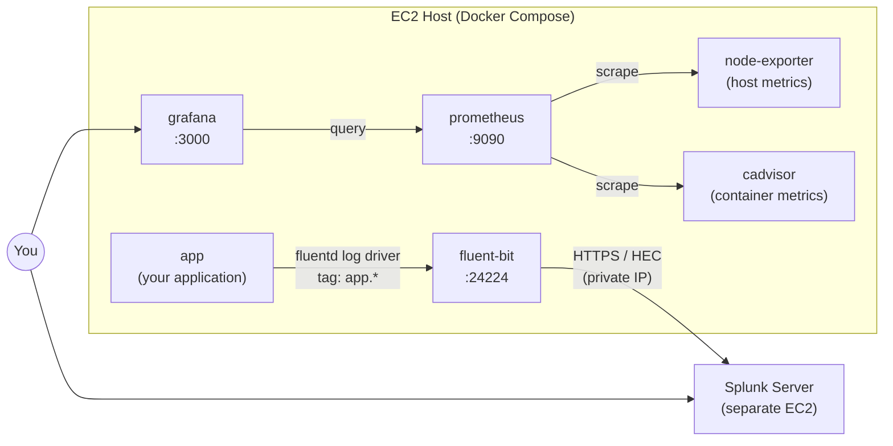

# Observability Stack: Logs to Splunk, Metrics to Prometheus & Grafana

A Docker Compose stack that adds **centralised logging** and **metrics monitoring** to an application running on a single EC2 host.

| Signal | Path |
|--------|------|
| **Logs** | App container → Docker `fluentd` log driver → **Fluent Bit** → **Splunk** (HEC, separate server) |
| **Host metrics** | **Node Exporter** → **Prometheus** → **Grafana** |
| **Container metrics** | **cAdvisor** → **Prometheus** → **Grafana** |

---

## Table of Contents

1. [Architecture](#architecture)
2. [Repository Layout](#repository-layout)
3. [Services Explained](#services-explained)
4. [Configuration (`.env`)](#configuration-env)
5. [Ports](#ports)
6. [Getting Started](#getting-started)
7. [How Log Shipping Works](#how-log-shipping-works)
8. [Verifying the Setup](#verifying-the-setup)
9. [Security Considerations](#security-considerations)
10. [Troubleshooting](#troubleshooting)
11. [Customisation Checklist](#customisation-checklist)

---

## Architecture



**In short:** logs go to Splunk for searching and investigation; metrics go to Prometheus and are visualised in Grafana.

---

## Repository Layout

```
.
├── docker-compose.yml            # Defines all services (this document)
├── .env                          # Secrets & environment-specific values (env.txt)
├── fluent-bit/
│   └── fluent-bit.conf           # Fluent Bit pipeline: input → filter → Splunk output
├── prometheus/
│   └── prometheus.yml            # Scrape targets (node-exporter, cadvisor, ...)
└── grafana/
    └── provisioning/             # Auto-loaded datasources & dashboards
```

> The `fluent-bit/`, `prometheus/` and `grafana/provisioning/` files are mounted by the compose file and must exist before you start the stack. They are not covered here.

---

## Services Explained

### 1. `app` – Your application
- Placeholder image `nginx:alpine`; **replace it with your own image**.
- Publishes `80:80` (host:container); change to match your app's port.
- Uses the Docker **`fluentd` logging driver** to send stdout/stderr to Fluent Bit at `127.0.0.1:24224`.
- `fluentd-async: "true"` lets the container start and run even if Fluent Bit is down. Logs are buffered by Docker and delivered when it returns.
- `tag: "app.{{.Name}}"` tags each log line with the container name. The tag **must start with `app.`** so it matches the Fluent Bit config.

### 2. `fluent-bit` – Log shipper
- Image: `fluent/fluent-bit:3.2`.
- Receives logs from Docker on `24224`, enriches them with `ENVIRONMENT`, and forwards them to Splunk's **HTTP Event Collector (HEC)** using `SPLUNK_HOST` and `SPLUNK_HEC_TOKEN`.
- Port `24224` is bound to **`127.0.0.1` only**, so it is reachable just from the host (where the Docker daemon runs) and not from the network.
- `fluentbit-buffer` volume provides on-disk buffering so logs survive restarts and short Splunk outages.
- Its own logs use the `json-file` driver, limited to 3 files of 10 MB each. This avoids a loop where Fluent Bit would log into itself.

### 3. `prometheus` – Metrics storage
- Image: `prom/prometheus:v2.54.1`.
- Retention is **15 days** (`--storage.tsdb.retention.time=15d`).
- Config comes from `./prometheus/prometheus.yml`, which defines what to scrape.
- Data persists in the `prometheus-data` volume.

### 4. `grafana` – Dashboards
- Image: `grafana/grafana:11.2.0`.
- Admin credentials come from `.env`; self sign-up is disabled (`GF_USERS_ALLOW_SIGN_UP=false`).
- `./grafana/provisioning` is mounted read-only so datasources and dashboards load automatically on start.
- Data persists in the `grafana-data` volume.

### 5. `node-exporter` – EC2 host metrics
- Image: `prom/node-exporter:v1.8.2`.
- Exposes CPU, memory, disk and network metrics of the **host**, not the container.
- Uses `pid: host` and mounts `/` read-only at `/host`, with `--path.rootfs=/host`, to read host-level data.
- No ports are published; Prometheus scrapes it over the internal Compose network.

### 6. `cadvisor` – Container metrics
- Image: `gcr.io/cadvisor/cadvisor:v0.49.1`.
- Exposes per-container CPU, memory, network and filesystem usage.
- Needs `privileged: true`, `/dev/kmsg` and read-only mounts of `/`, `/var/run`, `/sys` and `/var/lib/docker` to inspect containers.
- No ports are published; Prometheus scrapes it over the internal Compose network.

### Volumes

| Volume | Used by | Purpose |
|--------|---------|---------|
| `prometheus-data` | prometheus | Time-series database |
| `grafana-data` | grafana | Users, dashboards, settings |
| `fluentbit-buffer` | fluent-bit | Disk buffer for undelivered logs |

---

## Configuration (`.env`)

Compose reads these values automatically from a `.env` file in the same directory.

| Variable | Description | Example |
|----------|-------------|---------|
| `SPLUNK_HOST` | **Private IP** of the Splunk server | `172.31.17.141` |
| `SPLUNK_HEC_TOKEN` | HEC token; must match the token created in Splunk | `11111111-2222-...` |
| `GRAFANA_ADMIN_USER` | Grafana admin username | `admin` |
| `GRAFANA_ADMIN_PASSWORD` | Grafana admin password | `ChangeMe_Grafana_Pass` |
| `ENVIRONMENT` | Label added to every log line | `production` |

> **Warning:** the values in the sample file are placeholders. Replace the HEC token and the Grafana password before deploying, and never commit `.env` to Git (add it to `.gitignore`).

---

## Ports

| Port | Service | Exposure | Notes |
|------|---------|----------|-------|
| `80` | app | Public | Change to your app's port |
| `24224` | fluent-bit | `127.0.0.1` only | Docker log driver endpoint |
| `9090` | prometheus | **Public** (as written) | See [Security](#security-considerations) |
| `3000` | grafana | Public | Login required |
| none | node-exporter, cadvisor | Internal only | Scraped by Prometheus |

---

## Getting Started

### Prerequisites
- A Linux host (e.g. EC2) with **Docker** and the **Docker Compose plugin**.
- A reachable **Splunk server** with HEC enabled and a token created.
- Network access from this host to Splunk's HEC port (default `8088`) via the **private IP**. Check the security-group rules.
- The `fluent-bit.conf`, `prometheus.yml` and Grafana provisioning files in place.

### Steps

```bash
# 1. Edit your values
nano .env

# 2. Replace the placeholder image and ports in docker-compose.yml (app service)

# 3. Start the stack
docker compose up -d

# 4. Check status
docker compose ps
```

### Access

| Tool | URL |
|------|-----|
| Application | `http://<host-public-ip>:80` |
| Grafana | `http://<host-public-ip>:3000` |
| Prometheus | `http://<host-public-ip>:9090` |
| Splunk | `http://<splunk-ip>:8000` (default web UI) |

### Stop / Clean up

```bash
docker compose down        # stop, keep data
docker compose down -v     # stop and DELETE all volumes (metrics, dashboards, buffer)
```

---

## How Log Shipping Works

1. The app writes to stdout/stderr.
2. Docker's **`fluentd` log driver** intercepts those lines and sends them to `127.0.0.1:24224`. The Docker daemon runs on the host, which is why Fluent Bit's port is published on the host's loopback.
3. Each record is tagged `app.<container_name>`.
4. **Fluent Bit** matches `app.*`, adds metadata such as `ENVIRONMENT`, and sends the records to Splunk HEC using the token.
5. Logs appear in Splunk, where you can search them by environment and container name.

Key design choices:
- **Async logging**: the app never blocks or fails to start because the log pipeline is down.
- **Disk buffering**: Fluent Bit buffers to a volume to reduce log loss during outages.
- **Loopback binding**: the log intake port is not exposed to the network.

---

## Verifying the Setup

**Logs**
```bash
docker compose logs -f fluent-bit          # look for successful HEC output, no 4xx/5xx errors
curl -k https://<SPLUNK_HOST>:8088/services/collector/health   # HEC reachability (adjust scheme/port to your setup)
```
Then search in Splunk (adjust the index to your setup): `index=* environment=production`

**Metrics**
- Open Prometheus → **Status → Targets**: all targets should be `UP`.
- Open Grafana → **Connections → Data sources**: Prometheus should be present and healthy.
- Example queries in Prometheus:
  - Host CPU: `100 - (avg by(instance)(rate(node_cpu_seconds_total{mode="idle"}[5m])) * 100)`
  - Container memory: `container_memory_usage_bytes{name="app"}`

---

## Security Considerations

| Risk | Detail | Recommendation |
|------|--------|----------------|
| **Prometheus exposed to the Internet** | `9090:9090` has no authentication | Use `127.0.0.1:9090:9090` (the commented line) and an SSH tunnel, or restrict the security group to your IP |
| **Grafana on a public port** | Default admin user and weak password | Use a strong password, restrict by security group, or place behind a reverse proxy with TLS |
| **Secrets in `.env`** | HEC token and admin password in plain text | Keep out of Git; consider AWS Secrets Manager or SSM Parameter Store |
| **cAdvisor is privileged** | Broad access to the host | Acceptable for monitoring, but never expose its port |
| **Node Exporter mounts `/`** | Read-only, but exposes host data | Keep it internal only (as configured) |
| **Splunk traffic** | Sent over a private IP | Keep Splunk reachable only from within the VPC; use HTTPS for HEC if possible |

SSH tunnel example for local-only Prometheus:
```bash
ssh -L 9090:localhost:9090 ec2-user@<host-public-ip>
# then open http://localhost:9090
```

---

## Troubleshooting

| Symptom | Likely cause | Fix |
|---------|--------------|-----|
| App container fails to start with a fluentd error | Fluent Bit not up and async disabled/old Docker behaviour | Keep `fluentd-async: "true"`; ensure `fluent-bit` is running |
| No logs in Splunk | Wrong `SPLUNK_HOST` / token, HEC disabled, firewall blocks the port | Check `docker compose logs fluent-bit`; test HEC health endpoint; check security groups |
| Logs arrive but are missing from searches | Tag does not start with `app.` or wrong index | Verify `tag:` in the compose file against the `Match` in `fluent-bit.conf`; check the HEC token's allowed index |
| Prometheus target `DOWN` | Wrong target name or port in `prometheus.yml` | Use the service names (e.g. `node-exporter:9100`, `cadvisor:8080`) |
| cAdvisor won't start | `/dev/kmsg` missing or restricted | Check the host kernel and Docker permissions |
| Grafana has no dashboards | Provisioning path or file format wrong | Check `docker compose logs grafana` and the files under `grafana/provisioning/` |
| Lost metrics after restart | Volumes removed with `down -v` | Avoid `-v` unless you intend to reset |

---

## Customisation Checklist

- [ ] Replace the `app` image and ports
- [ ] Set real `SPLUNK_HOST` and `SPLUNK_HEC_TOKEN`
- [ ] Change the Grafana admin password
- [ ] Bind Prometheus to `127.0.0.1` (or restrict via security group)
- [ ] Confirm `fluent-bit.conf` matches the `app.*` tag
- [ ] Confirm `prometheus.yml` lists `node-exporter` and `cadvisor`
- [ ] Add `.env` to `.gitignore`
- [ ] Adjust Prometheus retention (`15d`) to your needs and disk size
- [ ] Import Grafana dashboards, e.g. Node Exporter Full (ID `1860`) and a cAdvisor dashboard
